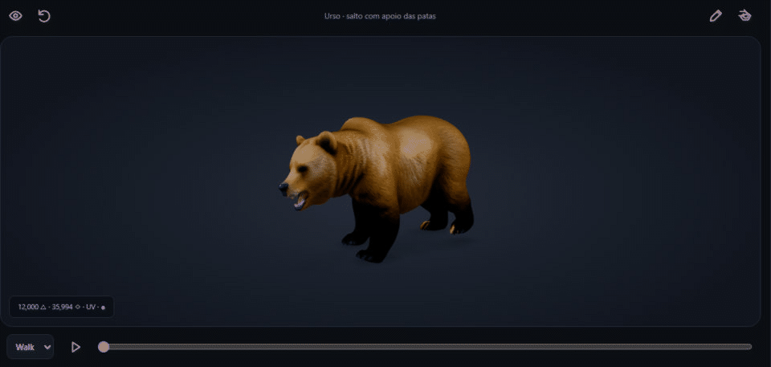
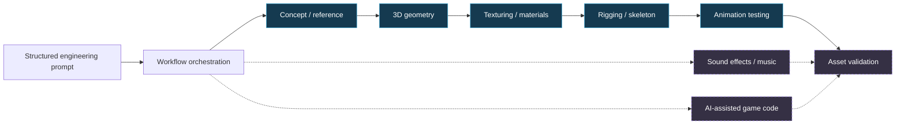
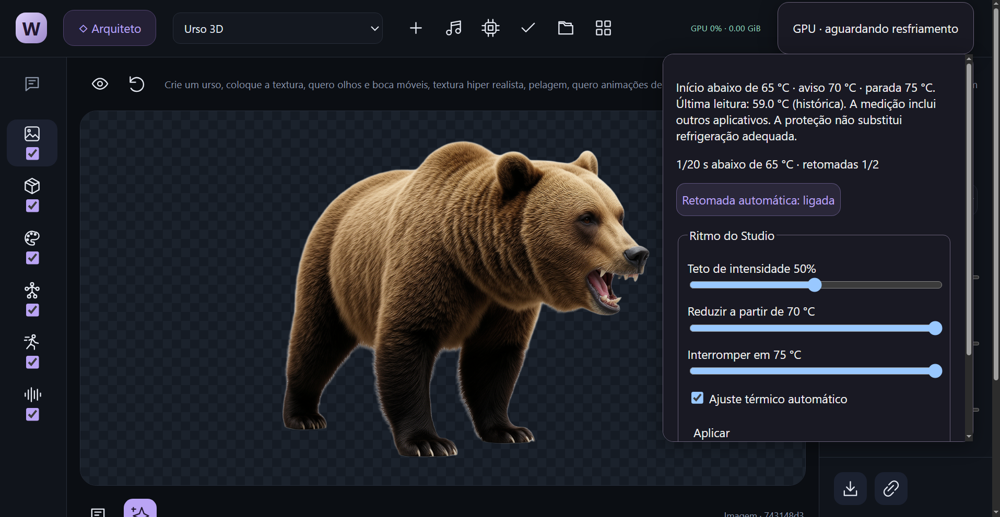
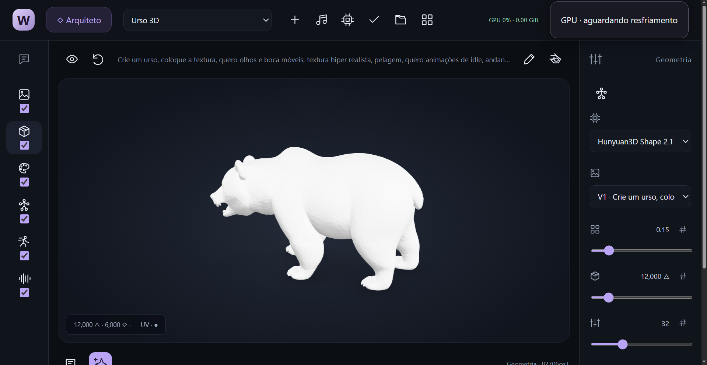
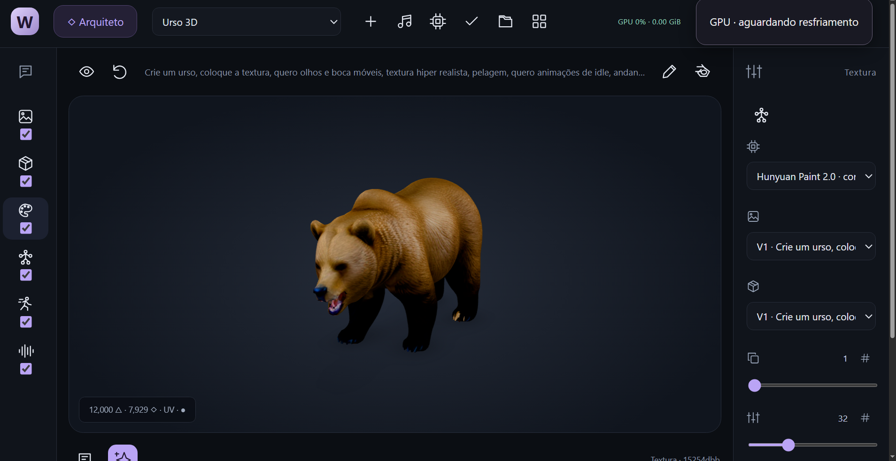
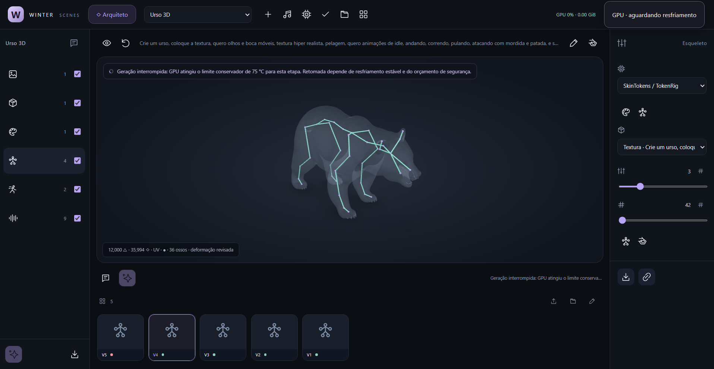
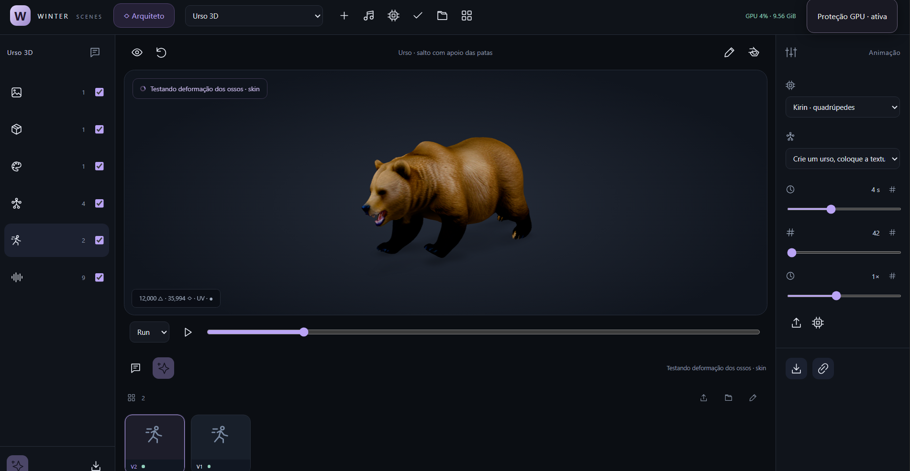
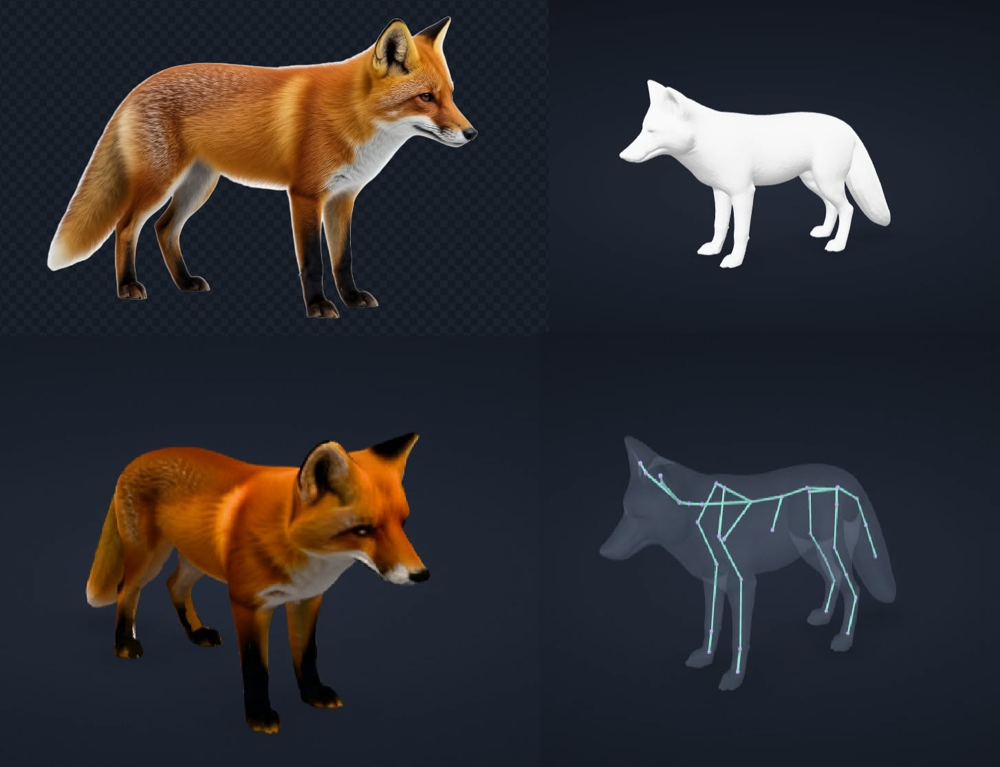

# ❄️ WINTER ASSET STUDIO

### An offline, AI-powered production environment for game assets

**From an engineering prompt to 3D characters, animation, audio, and game-ready workflows.**

  
  
  
  

*One workspace. Multiple AI models. A unified creative pipeline.*

[**The Pipeline**](#-production-pipeline) · [**Character Showcase**](#-bear-character-showcase) · [**Audio Preview**](#-audio--sound-design) · [**Roadmap**](#-roadmap)

---

> [!IMPORTANT]
> **Proprietary project | Public portfolio only | Closed source**
>
> Winter Asset Studio is an independently authored software project created and controlled by **Alexandre Kamimura Paulo (Wintersky)**. This public repository exists exclusively to showcase the project, its development progress, and selected demonstrations as part of the creator's professional portfolio.
>
> The studio is **not open source**. Its source code, internal implementation, private configurations, and application builds are not provided and will not be released through this repository. Publication of this showcase does not grant a license to use, reproduce, modify, distribute, or commercialize the creator's proprietary work beyond rights provided by applicable law or GitHub's terms. Any additional permission requires prior express written authorization from the rights holder. Third-party models and components remain subject to their respective licenses.
>
> **Copyright © 2026 Alexandre Kamimura Paulo. All rights reserved in the creator's original proprietary work.**

## ✦ Overview

**Winter Asset Studio** is an experimental desktop environment for building game assets with **locally executed AI models**, coordinated through structured engineering prompts and an integrated workflow.

The goal is to connect the stages that normally require jumping between many different tools: concept generation, 3D geometry, materials, rigging, animation, sound design, and eventually game-system development.

Rather than relying on hosted inference services, the studio is built around a **local-first, offline approach**. AI workloads run on the developer's GPU; models and required dependencies must be obtained during setup.

> **Development note:** This is a work-in-progress project. The images document real interface states and experiments, while the full end-to-end workflow is still being developed. Features listed in the roadmap are goals, not completed capabilities.

  
   
  Animated walking preview captured in the local studio workspace.

## ⚡ What makes it different?

<table>
<tr>
<td width="50%"><b>🖥️ Fully local</b> Models execute on local GPU hardware, avoiding cloud inference for the core workflow.</td>
<td width="50%"><b>🔒 Private by design</b> Creative experiments, intermediate results, and working files remain under the developer's control.</td>
</tr>
<tr>
<td><b>🧠 Prompt-driven workflow</b> Structured engineering prompts are intended to coordinate specialized tools across production stages.</td>
<td><b>🌡️ GPU-aware execution</b> The prototype UI includes temperature monitoring, cooling thresholds, and execution safeguards.</td>
</tr>
<tr>
<td><b>🧩 Modular pipeline</b> Different models and tools can be evaluated independently and integrated as workflows mature.</td>
<td><b>🎮 Built for game production</b> The long-term goal is to progress from concepts to assets that can be validated and used in game engines.</td>
</tr>
</table>

## 🔁 Production pipeline

**Solid path:** stages shown in the current visual experiments. **Dashed paths:** broader integration and validation goals, not claims of finished automation.

---

## 🐻 Bear character showcase

A practical test character used to explore the studio's asset-production stages, from concept to animation and sound.

### 01 / Concept & GPU control

A character reference inside the studio workspace, with local GPU workload monitoring and thermal protection settings visible in the interface.

### 02 / 3D geometry

An example 3D mesh preview. **Hunyuan3D Shape 2.1** is shown as the selected geometry-stage option in this experiment.

### 03 / Texturing & materials

The character after the texture stage. **Hunyuan Paint 2.0** appears in the interface for this test.

### 04 / Rigging & skeleton

Skeletal structure and deformation tests. The screenshot shows **SkinTokens / TokenRig** among the rigging options and an example of a job interrupted by a GPU safeguard.

### 05 / Animation

A quadruped animation workspace featuring the character, timeline controls, and movement testing.

**Walking preview**

  
   
  Animated capture of the quadruped walking test in the studio.

---

## 🔊 Audio & sound design

An experimental growl sound from the project's audio workflow:

**[↓ Bear growl sound effect (MP3)](audio/bear-growl-preview.mp3)**

<!-- To enable inline playback, upload an MP4 sound preview directly into the GitHub README editor and place the generated GitHub user-attachments URL on its own line here. -->

*The MP3 link opens or downloads the original sound sample depending on the browser. An inline video-based sound preview can be added using a GitHub media attachment.*

Sound effects and music form part of the broader intended production pipeline; this public showcase currently contains one sound-effect example.

---

## 🦊 Additional example / Fox asset pipeline

Another character experiment showing multiple visual stages, including the reference, 3D form, textured appearance, and skeletal rig view.

---

## 🛠️ Architecture & technical direction

| Area | Current direction |
|:--|:--|
| Runtime | Local desktop environment, offline after initial setup |
| AI processing | Local GPU inference using specialized models |
| Orchestration | Engineering prompts and modular workflows |
| 3D | Geometry generation, texturing, rigging, animation experiments |
| Monitoring | GPU temperature and task interruption controls shown in the UI |
| Audio | Experimental local sound-effect workflow |
| Target | More reliable, testable, reusable game-production pipelines |

**Development hardware:** NVIDIA RTX 5070 Ti (16 GB VRAM). This is an example development setup, **not** a verified minimum system requirement or compatibility guarantee.

The project is not currently distributed as an installable application. Its source code, AI model configurations, and internal implementation remain private.

## 🧭 Roadmap

- [x] Multi-stage asset workflow interface and prototype experiments
- [x] Screenshots of geometry, texturing, rigging, and animation workspaces
- [x] Animated walking preview of the bear character
- [x] Experimental sound-effect preview
- [x] GPU-monitoring and protection controls shown in the UI
- [ ] Demonstrated, validated end-to-end unattended asset generation
- [ ] Consistent character rigging and reusable motion pipeline
- [ ] Broader SFX and music generation integration
- [ ] AI-assisted game-code and engine integration workflow
- [ ] Automated asset validation, export, and production-quality testing

*Checked items indicate demonstrated prototype work or UI features, not a claim that the entire pipeline is production-ready.*

## 🔐 Code & availability

This repository is a **public portfolio showcase** and contains **documentation and example media only**. It does not include the proprietary studio source code, installed AI models, configuration secrets, or a downloadable application.

The studio is closed-source and proprietary. No source-code release or application distribution is offered through this portfolio. The creator reserves all applicable rights in original proprietary material. Third-party components remain governed by their respective licenses.

This project is under active development. The screenshots and examples are intended to communicate its direction and experimental progress, not a finished commercial product.

## 👤 Creator

**Alexandre Kamimura Paulo (Wintersky)**  
Independent developer · Software & AI systems · Game development

[GitHub](https://github.com/AlexWintersky) · [Email](mailto:wintersky.dev@gmail.com)

---

**Built locally. Designed to turn ideas into interactive worlds.**

Winter Asset Studio · Public project showcase

